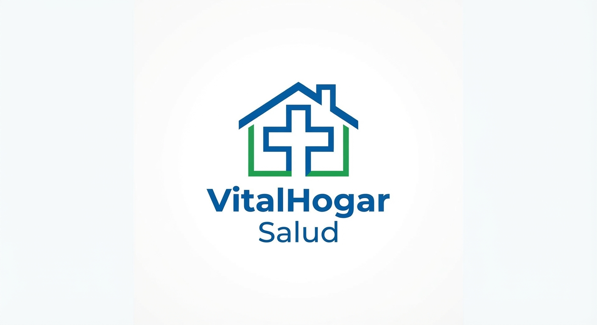

# 🏥 VitalHogar Salud - Sistema de Gestión de Planes Médicos

## 🏢 Identidad Corporativa

### **Nombre de la Empresa**
**VitalHogar Salud**

### **Misión**
> Proveer servicios integrales de atención médica preventiva domiciliaria con altos estándares de calidad, ofreciendo planes accesibles y personalizados para cada grupo familiar. Nos comprometemos a garantizar una atención oportuna y humana respaldada por herramientas digitales eficientes.

### **Visión**
> Ser en 2030 la empresa líder en telemedicina y atención de salud preventiva a domicilio en Colombia, reconocida por la excelencia operativa de su sistema informático y la alta satisfacción de las familias atendidas.
